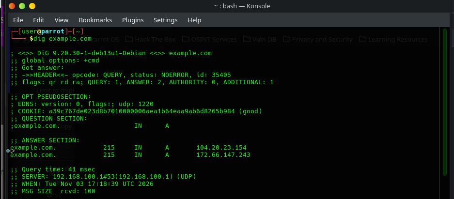
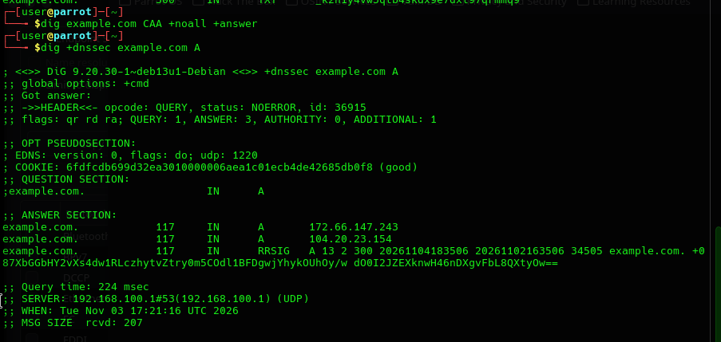
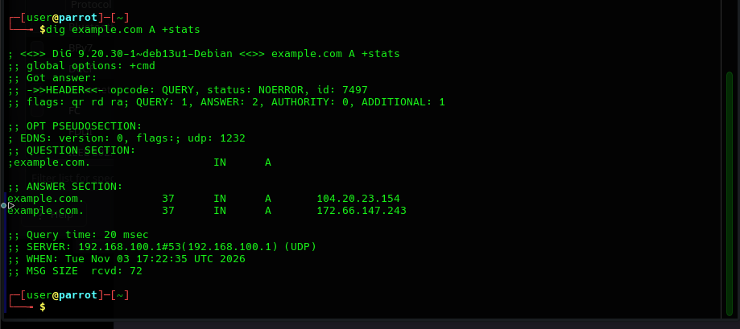

# Lab Report: Practical DNS Investigation Using `dig`
**Author:** Serah Mulwa  
**Date:** November 3, 2026  
**Module:** Day 16 - DNS Security, Investigation, and Threat Detection  

---

## 1. Objective
The goal of this practical laboratory exercise is to utilize `dig` (Domain Information Groper) from a Parrot OS command-line environment to query various DNS record types, analyze raw DNS headers and response sections, inspect cryptographic validation flags, and measure performance telemetry against the reserved testing domain `example.com`.

---

## 2. Environment & Tool Verification
* **Workstation OS:** Parrot OS Security VM (VirtualBox)
* **Tool Utilized:** `dig` (DiG 9.20.30-1~deb13u1-Debian)
* **Target Domain:** `example.com` (IANA reserved testing domain)

---

## 3. Investigation & Query Results

### 3.1 Basic DNS Lookup (`dig example.com`)
Executed a standard lookup against the target domain to examine header structure, question sections, and answer records.
* **Command:** `dig example.com`
* **Observation:** Returned multiple IPv4 `A` records with active TTL values and standard resolver metrics.
* **Screenshot Evidence:** 

### 3.2 Specific Record Type Enumeration (`+noall +answer`)
Queried individual record categories using clean display modifiers to evaluate zone configuration:
* **`A` Record (IPv4):** Returned target IPs (`172.66.147.243`, `104.20.23.154`).
* **`AAAA` Record (IPv6):** Returned IPv6 address bindings (`2606:4700:10::ac42:93f3`, etc.).
* **`MX` Record (Mail Exchange):** Returned priority and mail server routing.
* **`NS` Record (Nameservers):** Identified authoritative nameservers (`elliott.ns.cloudflare.com`, `hera.ns.cloudflare.com`).
* **`SOA` Record (Start of Authority):** Retrieved zone serial numbers and administrator details.
* **`TXT` Record (Text / Security Policies):** Discovered SPF validation strings (`"v=spf1 -all"`).
* **`CAA` Record (Certificate Authority Authorization):** Verified certificate issuance policies.
* **Screenshot Evidence:** 

### 3.3 DNSSEC Signature Inspection (`+dnssec`)
Queried the zone with the DNSSEC extension flag enabled to verify cryptographic record handling.
* **Command:** `dig +dnssec example.com A`
* **Observation:** Successfully retrieved the `RRSIG` resource record signature alongside the standard `A` record answers.
* **Screenshot Evidence:** 

### 3.4 Telemetry & Performance Stats (`+stats`)
Evaluated query performance metrics from the resolver response footer.
* **Command:** `dig example.com A +stats`
* **Key Metrics Observed:**
  * **Query Time:** 20 msec
  * **Server Resolver:** `192.168.100.1#53 (UDP)`
  * **Message Size Received:** 72 bytes
* **Screenshot Evidence:** 

---

## 4. Laboratory Summary Questions & Answers

1. **Which record types returned answers?**  
   * `A`, `AAAA`, `NS`, `SOA`, and `TXT` returned valid answer sections.
2. **Which did not?**  
   * `CAA` returned no active records for this specific query scope (`NODATA` response with `NOERROR` status).
3. **What was the TTL?**  
   * TTL values varied dynamically during testing (observed between 37 seconds and 215 seconds depending on local cache freshness).
4. **Which resolver answered the query?**  
   * Local gateway resolver: `192.168.100.1` on port 53 via UDP.
5. **How long did the lookup take?**  
   * Ranged between 20 milliseconds and 41 milliseconds depending on network jitter and cache state.
6. **Did the response contain DNSSEC information?**  
   * Yes, when queried with `+dnssec`, the response successfully surfaced the `RRSIG` cryptographic signature record.

---

## 5. Conclusion
This lab successfully demonstrated the operational mechanics of `dig` for threat hunting and zone enumeration. As a junior SOC analyst, understanding how to isolate specific record types and verify DNS headers is critical for investigating malicious domains without triggering security anomalies.
