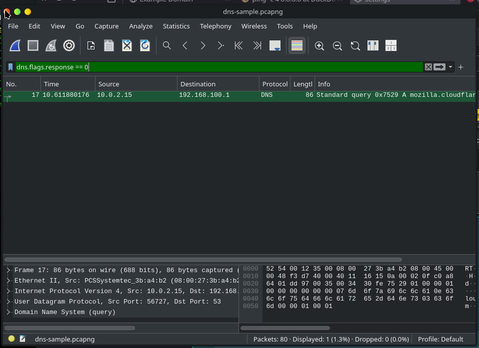
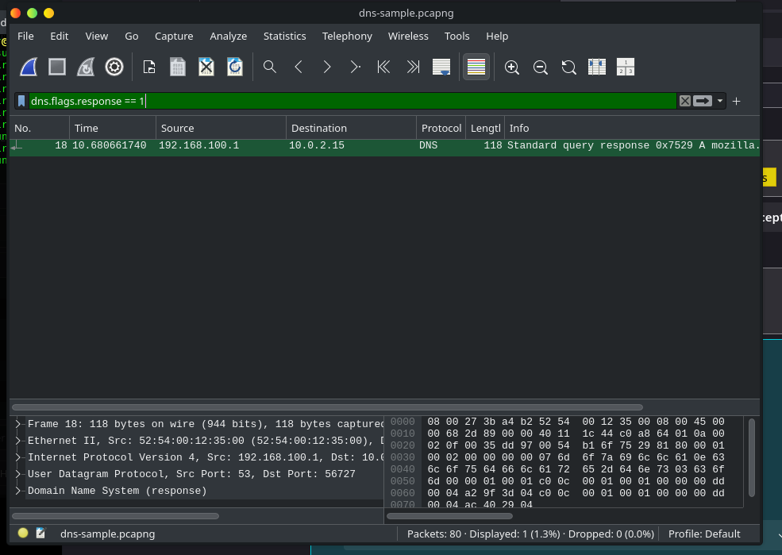
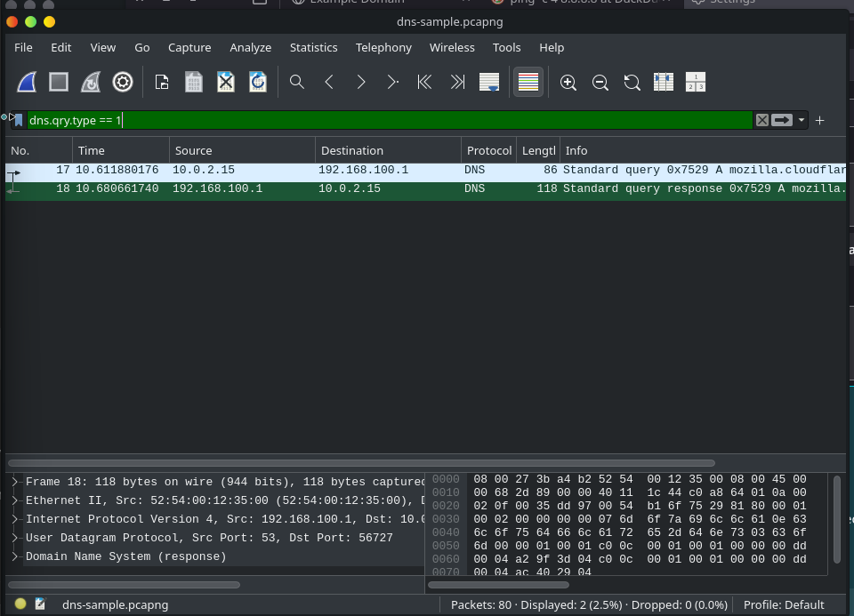
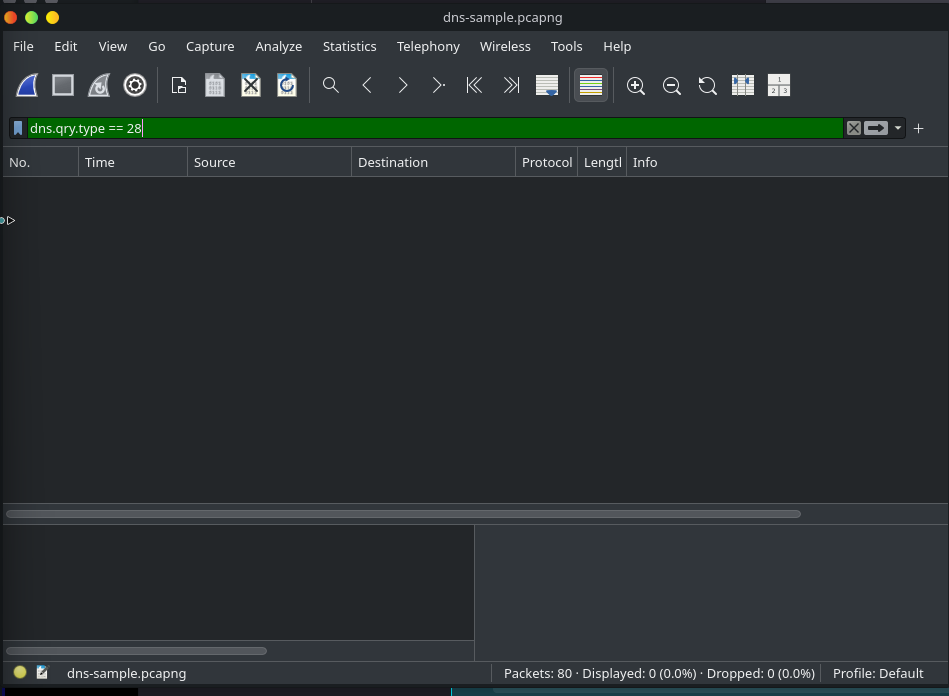
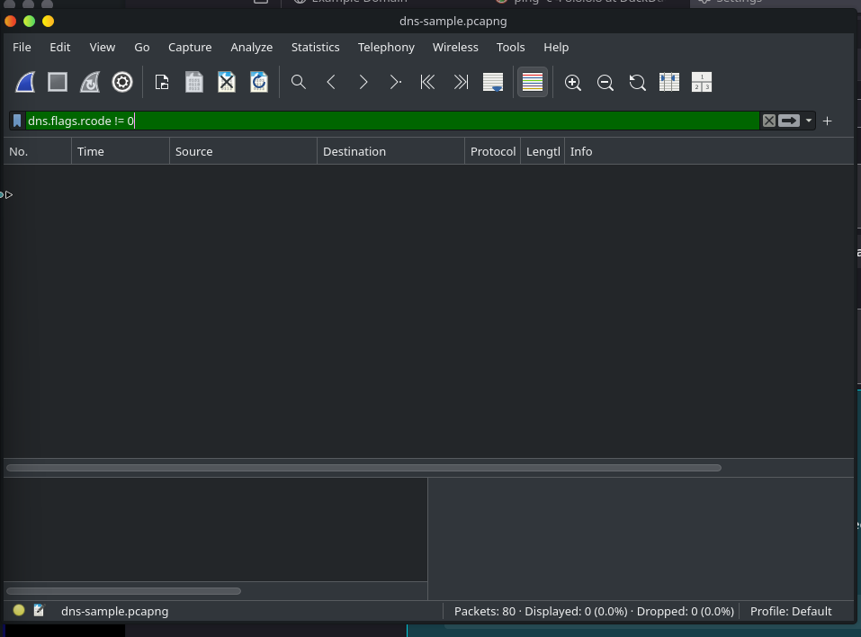
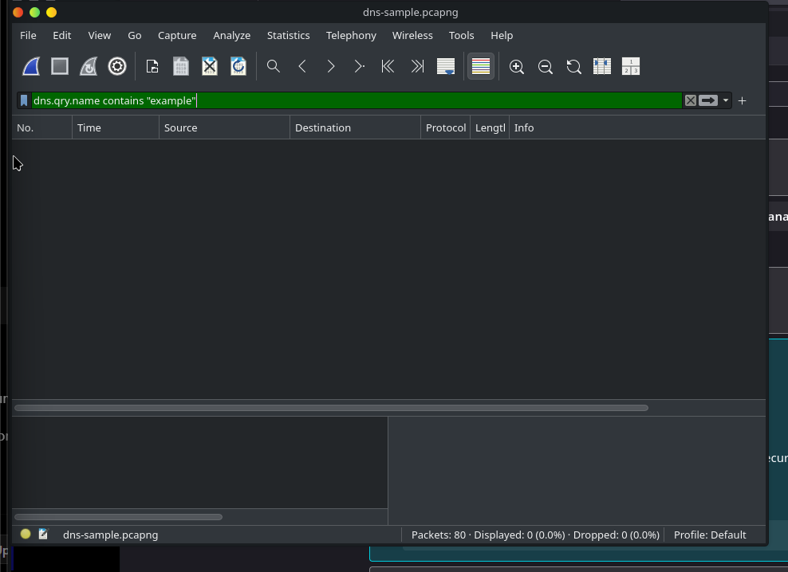

# Lab Report: DNS Traffic Analysis & Packet Forensics in Wireshark
**Author:** Serah Mulwa  
**Date:** November 3, 2026  
**Module:** Day 16 - DNS Security, Investigation, and Threat Detection  

---

## 1. Objective
The goal of this practical laboratory exercise is to bridge network packet analysis (from Day 15) with advanced DNS telemetry inspection. Using Wireshark in Parrot OS, we apply precise display filters to isolate queries, responses, record types, error codes, and potential tunneling indicators within network packet captures (`.pcapng`).

---

## 2. Environment & Tool Setup
* **Workstation OS:** Parrot OS Security VM (VirtualBox)
* **Analysis Tool:** Wireshark 4.4.19
* **Sample Capture:** `dns-sample.pcapng`

---

## 3. Step-by-Step Wireshark Filtering & Observations

### 3.1 Isolating Queries vs. Responses (`dns.flags.response`)
To understand the direction of DNS communication and calculate transaction timing, we separate client requests from server replies.
* **Filter for Queries (Client Requests):** `dns.flags.response == 0`
  * *Observation:* Successfully isolated outgoing client request packets (e.g., Frame 17 showing a standard query for `mozilla.cloudflare-dns.com` originating from local IP `10.0.2.15` to gateway `192.168.100.1`).
  * *Screenshot Evidence:* 

* **Filter for Responses (Server Replies):** `dns.flags.response == 1`
  * *Observation:* Successfully isolated incoming resolver replies (e.g., Frame 18 returning the answer payload). We can link queries and responses using the **Transaction ID (`dns.id`)** field.
  * *Screenshot Evidence:* 

### 3.2 Filtering by Record Types (`dns.qry.type`)
Attackers and analysts query specific record types depending on the investigation context.
* **IPv4 `A` Records (Type 1):** `dns.qry.type == 1`
  * *Observation:* Displayed standard IPv4 address lookups.
  * *Screenshot Evidence:* 

* **IPv6 `AAAA` Records (Type 28):** `dns.qry.type == 28`
  * *Observation:* Filtered for IPv6 queries. In this specific sample capture, 0 packets matched, indicating IPv6 was not queried.
  * *Screenshot Evidence:* 

### 3.3 Investigating Errors and Anomalies (`dns.flags.rcode`)
* **Filter for DNS Failures:** `dns.flags.rcode != 0`
  * *Observation:* Checked for non-zero error response codes (`SERVFAIL`, `NXDOMAIN`, `REFUSED`). The capture returned 0 packets, confirming clean resolution without upstream errors.
  * *Screenshot Evidence:* 

### 3.4 Screening for Domain Keywords & Subdomains (`dns.qry.name`)
* **Filter for Specific Strings:** `dns.qry.name contains "example"`
  * *Observation:* Used keyword filtering to hunt for specific target domains during threat hunting triage.
  * *Screenshot Evidence:* 

---

## 4. Laboratory Findings & Summary
1. **Total DNS Packets Reviewed:** 80 packets present in the sample capture.
2. **Dominant Query Types:** Standard `A` record queries (`Type 1`) constituted the majority of name resolution traffic.
3. **Response Codes:** 100% of responses returned `NOERROR` (RCODE 0), indicating healthy resolver operation with no dropped or failed queries.
4. **Anomalous Patterns:** No unusually long query names (`dns.qry.name.len > 60`) or high-entropy subdomains were observed, ruling out DNS tunneling activity in this baseline capture.

---

## 5. Conclusion
This lab reinforced how display filters empower SOC analysts to quickly sift through noisy network captures. By mastering filters like `dns.flags.response` and `dns.qry.type`, analysts can isolate malicious C2 beaconing or tunneling attempts from normal web browsing traffic in seconds.
